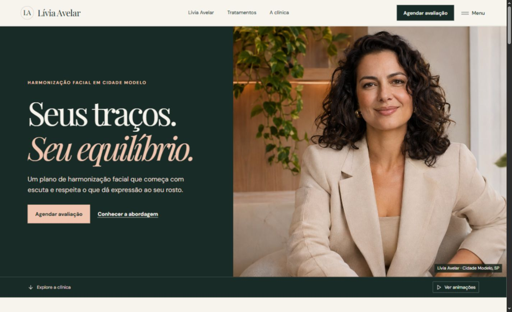
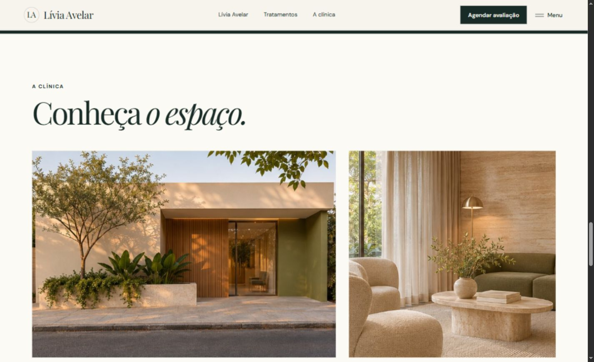

# Clínica Avelar

Projeto de portfólio para uma clínica de estética facial.

Criei esta demo para mostrar como uma clínica pode apresentar seu trabalho, ajudar a pessoa a entender a primeira avaliação e tornar o agendamento fácil de encontrar.

## Prévia do site






## O que a demo apresenta

- Capa com revelação de imagem e texto, menu de tela cheia e controle de movimento.
- Lista interativa de tratamentos, ilustração que acompanha a rolagem e galeria com navegação por toque e teclado.
- Fluxo de agendamento simulado, sem coleta de dados.

**React · TypeScript · Vite · CSS**

```bash
npm ci
npm run dev
```


